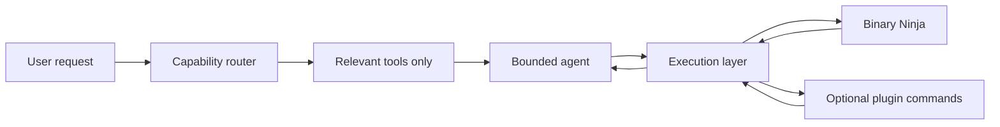

# Silvergun Architecture

## Design intent

Silvergun is a Python plugin for Binary Ninja 5.3+ that presents a fast, OpenAI-compatible AI coding partner without introducing a framework, local server, database, or mandatory dependency. The host Binary Ninja process remains the source of truth for program state. The agent is deliberately bounded to three tool-execution rounds by default, and a compact rule-based router selects a narrow capability slice before each model call.

> **Principle:** Gather locally, route narrowly, call remotely only when necessary, and commit Binary Ninja mutations only after explicit user approval.

| Layer | Responsibility | Performance boundary |
| --- | --- | --- |
| Configuration | Persist non-secret provider preferences in Binary Ninja user settings and API keys through its configured secret provider when available. | Model discovery is debounced and cached by `(base URL, API-key fingerprint)`; no model-list call occurs during normal analysis. |
| Provider client | Implement only `GET /models` and `POST /chat/completions` with Python's standard library. | Connection timeout, response limit, and low-temperature bounded completion requests prevent stalls and token bloat. |
| Capability registry | Build canonical `CapabilitySpec` records for native tools, adapters, and callable plugin commands in the active context. | Each capability has schema, evidence types, prerequisites, execution requirements, adapter, and `AVAILABLE`/`UNAVAILABLE`/`UI_ONLY`/`BROKEN` status. |
| Planner | Validate a bounded plan against the current registry before the provider sees it. | Unknown, unavailable, or dependency-invalid capabilities are rejected and replanned; keyword routing is only a fallback aid. |
| Router | Use deterministic keyword and scope matching as a compact initial hint for the planner. | The model receives the validated capability slice, not imaginary or UI-only tools. |
| Agent loop | Execute a strict tool-call loop with an operation budget, duplicate-call suppression, and a small transcript window. | Tools return compact, capped snapshots; assistant reasoning text is not requested or retained. |
| Execution | Route all adapter work through the Binary Ninja execution bridge; run independent remote analysis requests through a bounded pool only after immutable snapshots have been created. | Mutating actions are always serialized and explicitly confirmed by the user. |

## Request flow

The router first classifies the request into a small number of intents: patching, explanation, naming, type recovery, cross-reference analysis, annotation, vulnerability review, command discovery, or general investigation. It then adds the native tools required for that intent and at most a few relevant external plugin commands. The model can ask for `search_capabilities` when the initial slice is insufficient, which prevents every installed plugin from being exposed on every turn.

The runtime pipeline is contract-driven: `CapabilityRegistry` assembles the active `CapabilitySpec` records; `plan_from_route` creates and validates `InvestigationPlan`; the agent executes only validated capability IDs; `normalize_result` converts adapter output into `CapabilityResult` and `Evidence`; and `BinaryViewContext` carries the identity of the view used for the investigation. Provider-specific response parsing remains inside the provider client.

The **control plane** (provider tool calls, arguments, plan state, execution state, and structured results) is never sent directly to the sidebar. The provider client returns normalized `ChatCompletion` objects, adapters emit execution events, and the sidebar receives only presentation-safe activity, finding, warning, failure, and completion events. Legacy XML-like or JSON-in-text tool syntax is either normalized at the provider boundary or returned as a structured `ProviderError`; it is never treated as assistant prose.

## Tool and mutation policy

Native analysis tools collect a compact per-function snapshot built from HLIL, function metadata, callers/callees, strings, variables, and types. Results are hard-capped before entering the model context. External plugin commands are discovered via `PluginCommand.get_valid_list(context)` and may be executed only from an allowlist derived from the current compact capability slice. Write operations are separated from analysis: `apply_patch`, `rename_function`, `apply_function_type`, and `annotate_function` require an affirmative confirmation dialog even when proposed by the model.

| Operation class | Examples | Concurrency | User confirmation |
| --- | --- | --- | --- |
| Read | Snapshot, xrefs, function search, capabilities | Binary Ninja API read work is serialized; independent remote model jobs may fan out over frozen snapshots. | No |
| External command | Invoke another installed plugin command | Serialized with host context and only after capability routing. | Required if a command is not known read-only. |
| Mutation | Byte patch, rename, type change, tag/comment | Serialized on the host UI thread immediately after approval. | Always |

## Parallel investigation model

`fanout_investigate` accepts multiple function addresses and takes immutable snapshots before remote work. It deduplicates addresses, preserves input order, limits jobs to the configurable worker budget, and only fans out **read-only remote reviews**. This avoids concurrent mutation and avoids passing live Binary Ninja handles to worker threads. Each result is returned with its function address and any error, allowing a final synthesis call to combine results.

## Extensibility seam

External functionality is represented first as a compact discovery card and then as a canonical `CapabilitySpec`. Plugin discovery distinguishes `CALLABLE` commands from `UI_ONLY` commands; a discovered UI command is reported rather than passed to autonomous execution. The initial adapter wraps compatible Binary Ninja plugin commands, while BoolHunter and Binary Ninja built-ins implement the same adapter execution seam. Additional adapters can be placed in `_silvergun/adapters/` without changing the agent loop. The underscore-prefixed package is intentional because Binary Ninja loads the repository root as the `silvergun` plugin module.

## Deliberate non-goals

The initial version does not embed a browser, start a local daemon, maintain vector embeddings, depend on LangChain-style orchestration, persist decompilation dumps, automate arbitrary shell commands, or ask a model for hidden chain-of-thought. These exclusions directly protect startup time, context size, and auditability.

## Sources

The plugin packaging, command registration, settings, and background-task choices follow Binary Ninja’s official Python plugin and API documentation.[1][2][3]

[1]: https://docs.binary.ninja/dev/plugins.html "Writing Plugins — Binary Ninja Documentation"
[2]: https://docs.binary.ninja/dev/cookbook.html "Cookbook — Binary Ninja Documentation"
[3]: https://api.binary.ninja/binaryninja.plugin-module.html "plugin module — Binary Ninja API Documentation"

## References

[1] [Binary Ninja: Writing Plugins](https://docs.binary.ninja/dev/plugins.html)

[2] [Binary Ninja: Cookbook](https://docs.binary.ninja/dev/cookbook.html)

[3] [Binary Ninja: Python Plugin API](https://api.binary.ninja/binaryninja.plugin-module.html)

[4] [Binary Ninja: Settings API](https://api.binary.ninja/binaryninja.settings-module.html)

[5] [Binary Ninja: Secrets Provider API](https://api.binary.ninja/binaryninja.secretsprovider-module.html)
