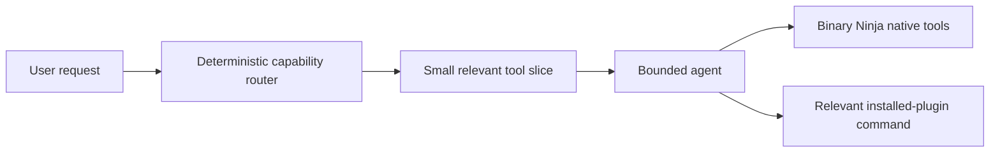

# Silvergun

**Silvergun** is a fast, dependency-free AI coding partner for Binary Ninja. It connects to any provider that implements the common OpenAI-compatible `GET /models` and `POST /chat/completions` endpoints, discovers models while you configure the provider, and limits every agent turn to the smallest relevant set of Binary Ninja and installed-plugin capabilities.

> **Design objective:** Make useful reverse-engineering assistance feel immediate by avoiding a planning model, heavyweight agent framework, local daemon, embeddings database, and full tool catalog on every request.

| Property | Implementation |
| --- | --- |
| Supported host | Binary Ninja 5.1+ with Python 3 support |
| Provider protocol | OpenAI-compatible `/models` and `/chat/completions` |
| Dependencies | None; Python standard library and Binary Ninja APIs only |
| Agent limit | Five tool rounds by default, configurable from one to eight |
| Remote concurrency | Bounded read-only function reviews over frozen snapshots |
| Mutations | Always display an explicit approval prompt before patch, rename, type, annotation, or external command execution |

## Capabilities

Silvergun supplies focused context-menu commands for the selected function and a free-form **Ask** command. The commands collect a compact HLIL-oriented snapshot rather than exporting the full binary or full decompilation database. This keeps remote requests small and makes the evidence used by the model inspectable.

| Command | Native tool path | Outcome |
| --- | --- | --- |
| Explain Function | `get_function_context`, `get_xrefs` | Describes likely purpose, inputs, outputs, side effects, and uncertainty. |
| Smart Patch | `get_function_context`, `apply_patch` | Proposes an exact byte patch; displays current and replacement bytes before writing. |
| Rename Function | `get_function_context`, `rename_function` | Suggests a semantic name with behavior-based justification. |
| Suggest Types | `get_function_context`, `get_type_evidence`, `apply_function_type` | Recovers a likely signature and applies only a user-approved declaration. |
| Analyze Xrefs | `get_function_context`, `get_xrefs` | Maps callers, callees, and control/data-flow boundaries. |
| Annotate Function | `get_function_context`, `annotate_function` | Drafts concise function comments and optional tags. |
| Find Vulnerabilities | `get_function_context`, `get_xrefs`, `review_vulnerabilities` | Produces evidence-based leads for manual verification; it does not claim a finding from heuristic matches alone. |
| Ask | Capability router | Routes natural-language requests to a small relevant tool slice. |
| Triage Binary | `semantic_search`, `query_binary` | Ranks likely-interesting functions locally, including stripped binaries, before spending a remote model call. |
| Verify Current Function | `get_verification` | Separates host-proven facts from inferred interpretation and attaches source locators. |
| Code Map | `code_map` | Produces a compact caller/callee graph for navigation and model-assisted explanation. |
| Analysis Notebook | `notebook_context`, `notebook_record` | Persists up to 200 evidence-backed findings per binary on the local machine. |

## Installation

Clone this repository into a Binary Ninja user plugin directory, or install it through a custom plugin repository. Binary Ninja Python plugins conventionally use a root `plugin.json` manifest and `__init__.py` entry point.[1]

```bash
git clone https://github.com/MShin13/silvergun.git "<Binary Ninja user plugins>/silvergun"
```

Restart Binary Ninja, then open **Plugins → Silvergun → Configure Provider...**. For development, Binary Ninja documents a fast reload workflow based on `importlib.reload` for most ordinary Python plugins.[1]

## Provider setup

Enter your provider’s API root, normally ending in `/v1`, and paste an API key. The dialog debounces edits for 420 ms, calls `/models` on a background thread, and replaces the model selector only when the latest request completes. This means models appear as soon as the endpoint and key are usable without freezing the Binary Ninja UI.

| Setting | Purpose | Default |
| --- | --- | --- |
| Provider Base URL | Root for OpenAI-compatible endpoints | `https://api.openai.com/v1` |
| Model | Selected model identifier | Empty until selected |
| Request Timeout | Per-request network deadline | 45 seconds |
| Maximum Tool Rounds | Strict agent operation budget | 3 |
| Parallel Reviews | Maximum simultaneous independent remote reviews | 3 |
| Context Budget | Maximum characters retained in a tool result | 18,000 |
| CA Bundle Path | Optional PEM bundle for providers whose embedded-Python roots are incomplete | Empty; system roots or certifi are attempted |

The base URL, model, limits, cached model names, and optional CA-bundle path are kept in Binary Ninja **user-scope settings**, never in project or resource settings. API keys are stored only through a configured Binary Ninja secrets provider. If no secrets provider is available, Silvergun will not persist the API key; the dialog reports this explicitly. Binary Ninja settings support hierarchical scopes, while `SecretsProvider` exposes storage through registered providers.[2] [3]

The reported `[SSL: CERTIFICATE_VERIFY_FAILED]` error is handled without an insecure bypass. Silvergun now builds a verifying SSL context, prefers an explicitly selected PEM bundle, then checks `SSL_CERT_FILE`/`REQUESTS_CA_BUNDLE`, and finally uses `certifi` when present before falling back to system roots. The provider dialog includes a **CA bundle** field and **Browse…** button. For a managed or custom provider, point this at the organization’s trusted PEM chain and refresh models again.

## Sidebar interface

Silvergun registers a native Binary Ninja sidebar widget with a ray-gun-inspired monochrome icon. Clicking the icon opens a compact interface attached to the active binary, with a free-form request box, provider shortcut, **Explain current function**, and **Find vulnerabilities** actions. Requests use the same bounded background agent as the menu commands; results are shown in the sidebar and in Binary Ninja’s report view. The widget is GUI-only and follows Binary Ninja’s sidebar registration model.[6]

## Dynamic capability routing

Silvergun does not dump every installed plugin command into every prompt. It indexes Binary Ninja commands valid in the active view and represents them as short capability cards. A rule-based router uses the user’s request to select a narrow native tool slice and, at most, four relevant extension commands. If the initial slice is insufficient, the model can invoke `search_capabilities` to retrieve a compact filtered catalog.



External commands are discovered through Binary Ninja’s `PluginCommand.get_valid_list` mechanism in the current context. Silvergun intentionally treats every third-party command as potentially mutating: it exposes the command only after routing and asks for explicit approval before execution. The host API supports querying and executing valid commands with a `PluginCommandContext`.[4]

## Evidence-first triage and notebook

Silvergun’s differentiator is a local trust layer rather than an opaque answer window. `semantic_search` performs bounded lexical-semantic triage across function names, signatures, and compact HLIL, while `query_binary` supports a small deterministic query language: `name~:text`, `calls:text`, `has:text`, and `addr:0xADDRESS`. These searches run locally and return ranked matches with evidence, so broad objectives can start quickly on stripped binaries without sending the whole program to a provider.

The `get_verification` tool labels host facts as proven and behavioral conclusions as inferred or hypothetical. Context snapshots include source locators for the BinaryView function table, `Function.type`, and HLIL instructions. Findings can be recorded in the local per-binary Analysis Notebook; its structured case file stores findings, hypotheses, unresolved questions, interesting functions, tool/plugin results, evidence links, related functions, xrefs, strings, IL references, search references, and progress state. Writes use a temporary file replacement and retain at most 200 records. `notebook_context` restores the latest case summary when the binary is reopened, while `notebook_search` makes prior evidence searchable. Restored case context is included in subsequent provider requests so the agent can continue the investigation; the notebook remains local and no telemetry is collected by Silvergun.

## Parallel investigation

When the agent needs several independent function reviews, it uses `fanout_investigate`. Silvergun resolves the requested functions and creates immutable compact snapshots first. Only the remote, read-only reviews run concurrently, under the configured worker budget. It never sends live Binary Ninja function objects across worker boundaries and never fans out mutations. Results retain input order and are returned to the agent for a single concise synthesis.

This model follows Binary Ninja’s separation between UI/main-thread work and non-GUI worker work: long-running work belongs off the UI thread, while UI interactions must be marshaled to the main thread.[5]

## Security and safety model

Silvergun is designed for interactive reverse engineering, not unattended binary modification. Its standard policy is conservative.

| Boundary | Policy |
| --- | --- |
| API credentials | Use Binary Ninja secrets storage where configured; never log keys. |
| Remote data | Send only the compact, bounded tool results necessary for the current request. |
| Model reasoning | Do not request or persist hidden chain-of-thought; responses should state evidence and uncertainty. |
| Patches | Display exact before/after byte strings and require approval. |
| Renames, types, comments, tags | Require approval immediately before mutation. |
| Other plugin commands | Treat as potentially mutating and require approval. |
| Agent execution | Limit tool rounds and suppress duplicate calls. |

## Extending Silvergun

The plugin exposes installed plugin commands through `_silvergun.external.ExternalCommandIndex`, which yields `ExternalCapability` cards. The underscore-prefixed package is intentional: Binary Ninja loads the repository root as the `silvergun` plugin module, so implementation modules must not reuse that top-level name. Native tools and extension commands share the same routing interface. To add a specialized integration, create another adapter under `_silvergun/adapters/` that supplies stable capability identifiers, compact descriptions, and an execution callback; the router and bounded agent need not change.

The initial version keeps the extension boundary intentionally small. It does not load arbitrary Python modules, run shell commands, maintain a local server, or introduce an orchestration framework. This minimizes attack surface and prevents startup or context cost from growing with the plugin ecosystem.

## Development

The repository includes no third-party dependency and uses the standard-library `unittest` runner. The unit tests exercise provider model discovery, standard tool-call payload construction, and narrow routing without requiring a Binary Ninja installation.

```bash
python3 -m compileall -q __init__.py _silvergun tests
python3 -m unittest discover -s tests -v
```

## Project structure

```text
.
├── __init__.py                 # Binary Ninja menu and context-command registration
├── plugin.json                 # Plugin Manager metadata
├── _silvergun/                # Private implementation package; root silvergun module is the BN loader
│   ├── config.py               # User settings, model cache, secret-provider key storage
│   ├── client.py               # Standard-library OpenAI-compatible transport
│   ├── notebook.py             # Atomic local per-binary findings notebook
│   ├── router.py               # Deterministic capability router
│   ├── external.py             # Installed PluginCommand index and guarded executor
│   ├── tools.py                # Compact analysis tools and approval-gated mutations
│   ├── agent.py                # Bounded tool loop and snapshot fan-out reviews
│   ├── ui.py                   # Debounced provider/model configuration dialog
│   ├── sidebar.py               # Clickable SidebarWidget interface
│   ├── assets/silvergun_icon.png # Ray-gun-inspired grayscale sidebar icon
│   └── commands.py             # Background task and Binary Ninja command callbacks
├── tests/test_core.py          # Isolated protocol and router tests
└── ARCHITECTURE.md             # Design rationale and boundaries
```

## License

This project is released under the [MIT License](LICENSE).

## References

[1] [Binary Ninja: Writing Plugins](https://docs.binary.ninja/dev/plugins.html)

[2] [Binary Ninja: Settings API](https://api.binary.ninja/binaryninja.settings-module.html)

[3] [Binary Ninja: Secrets Provider API](https://api.binary.ninja/binaryninja.secretsprovider-module.html)

[4] [Binary Ninja: Plugin Command API](https://api.binary.ninja/binaryninja.plugin-module.html)

[5] [Binary Ninja: Main Thread API](https://api.binary.ninja/binaryninja.mainthread-module.html)

[6] [Binary Ninja: UI Plugins and Sidebar Widgets](https://vector35-binaryninja-api.mintlify.app/plugins/ui-plugins)
